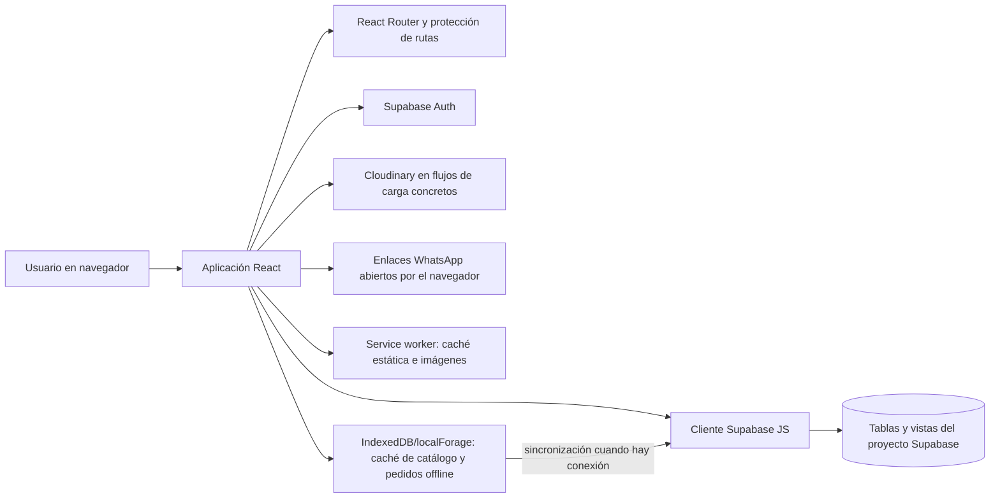
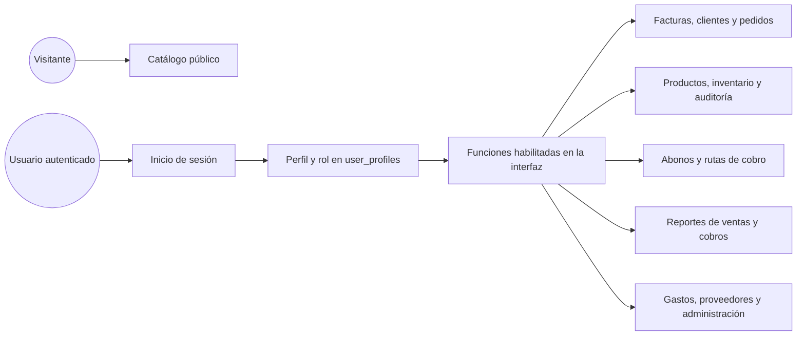
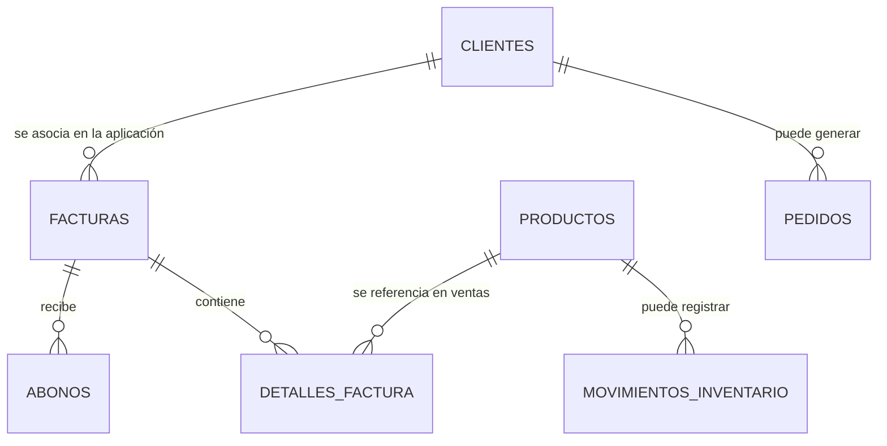
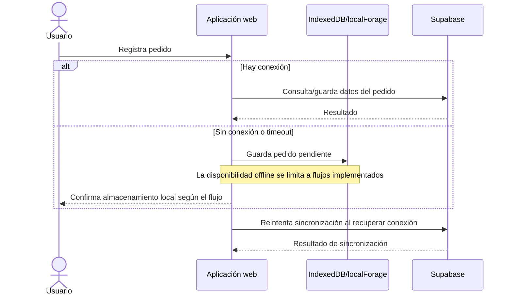

# Diagramas del sistema EBS

**Revisión:** 21 de octubre de 2026
**Base:** rutas, componentes y clientes de servicio visibles en el repositorio
**Alcance:** diagramas lógicos; no sustituyen el esquema real de Supabase ni la topología del despliegue

## 1. Componentes y comunicación observados

La figura no implica que todos los servicios estén configurados para producción ni que las políticas de acceso estén verificadas.

## 2. Actores y áreas funcionales

Los roles y páginas disponibles se aplican en la interfaz; la autorización en base de datos requiere validar las políticas RLS del proyecto Supabase.

## 3. Entidades y persistencia

El código consulta tablas con nombres como `user_profiles`, `clientes`, `productos`, `facturas`, `detalles_factura`, `abonos`, `pedidos`, `historial_inventario`, `preventa_pedidos`, `gastos_empresa`, `proveedores` y `facturas_proveedores`. Se usan además tablas de límites, catálogos, inmuebles, pagos y plataformas.

No se presenta un ERD con claves o cardinalidades porque el repositorio no contiene un esquema/migraciones completos y verificables. El modelo siguiente es únicamente conceptual:

Las relaciones dibujadas deben confirmarse contra el esquema instalado antes de usarse para migraciones o auditorías.

## 4. Flujo conceptual de pedido offline

## 5. Pendientes para un diagrama físico

Completar el diagrama de despliegue después de confirmar dominio/hosting, proyecto y región Supabase, servicio de imágenes, política RLS, copias de seguridad y versión exacta de aplicación liberada.
