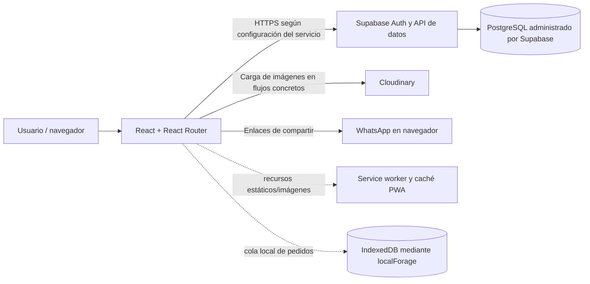

# Arquitectura técnica (estado verificable en el repositorio)

**Revisión:** 21 de octubre de 2026
**Fuente:** código y archivos de configuración del repositorio `pedido-ebs-web`
**Estado:** descripción de la implementación visible; no certifica el ambiente de producción

> La versión anterior incluía proveedores, planes, regiones, dominios, tiempos de rendimiento, esquemas SQL y garantías no demostrados por el repositorio. Se reemplaza esa información por hechos comprobables y pendientes de validación. La configuración real de Supabase, hosting, permisos y operación debe revisarse en los servicios correspondientes.

## 1. Vista general

La solución es una aplicación web cliente, de una sola página, construida con React y Vite. El navegador entrega la interfaz y se comunica directamente con Supabase mediante `@supabase/supabase-js` para autenticación y operaciones de datos. No se identifica un servidor de aplicación propio ni una API de backend desarrollada dentro de este repositorio.

El diagrama describe conexiones observadas en el código, no acredita titularidad, disponibilidad ni configuración de los servicios.

## 2. Tecnologías comprobadas

| Área | Dependencia/configuración en el repositorio |
|---|---|
| Interfaz | React `^18.2.0`, React DOM `^18.2.0` |
| Desarrollo y compilación | Vite `^7.0.0`, `@vitejs/plugin-react` |
| Navegación | React Router DOM `^6.30.1` |
| Backend cliente | `@supabase/supabase-js` `^2.55.0` |
| PWA | `vite-plugin-pwa` con Workbox, registro automático y actualización del service worker |
| Almacenamiento local | `localforage` para caché de catálogo/cola de pedidos |
| Exportación y documentos | Dependencias para PDF, hojas de cálculo y gráficos; el uso depende de cada módulo |
| Pruebas | Jest y Testing Library; hay pruebas unitarias/de componentes en el repositorio |

No hay evidencia en `package.json` de TypeScript, Redux, React Hook Form, ni de las versiones de infraestructura indicadas en documentos previos.

## 3. Estructura funcional visible

La aplicación organiza pantallas en `src/components`, lógica común en `src/lib`, hooks en `src/hooks` y acceso a Supabase en clientes y utilidades. Entre las áreas presentes en el código están:

- Catálogo público, catálogo con precio de detalle y catálogo de productos.
- Facturación, facturas guardadas, detalle y abonos.
- Clientes, pedidos, preventa e inventario, incluidos movimientos y auditoría.
- Campañas de catálogo y rutas de cobro.
- Reportes de ventas y cobros, dashboards y verificación de facturas físicas.
- Cuentas por pagar, gastos y vistas de contabilidad.
- Tipos y límites de clientes, consulta de catálogo Coopidrogas y funciones de análisis comercial.
- Herramientas de inmuebles, plataformas y mapa de locales.

La existencia de una pantalla no garantiza que sus tablas estén disponibles ni que el flujo completo haya superado pruebas de aceptación.

## 4. Rutas, sesión y roles

- `src/App.jsx` declara rutas públicas para catálogo y acceso, además de rutas internas protegidas.
- La autenticación utiliza Supabase Auth. Después de recuperar la sesión, el código consulta el perfil en `user_profiles` y obtiene atributos como rol y estado.
- `ProtectedRoute` limita el acceso a páginas en el cliente según la sesión y los roles requeridos. Los roles normalizados en el código incluyen `superadmin`, `admin`, `vendedor`, `inventario`, `contabilidad` y `cliente`.
- La protección de rutas en frontend no sustituye la autorización en backend. Las políticas RLS, permisos de tablas, funciones y acceso de cada rol deben auditarse en el proyecto Supabase; no se incluyen como migraciones completas en este repositorio.
- El cliente se configura con `VITE_SUPABASE_URL` y `VITE_SUPABASE_ANON_KEY`. Son valores visibles para el navegador; nunca debe exponerse aquí una clave `service_role` ni otra credencial privilegiada.

## 5. Persistencia, integraciones y trabajo sin conexión

### Supabase

El código consulta varias tablas, entre ellas `user_profiles`, `productos`, `clientes`, `facturas`, `detalles_factura`, `abonos`, `pedidos`, `historial_inventario`, `preventa_pedidos`, `gastos_empresa` y tablas asociadas a proveedores, inmuebles y catálogos. La lista no es un esquema completo: nombres, columnas, restricciones y relaciones definitivas deben verificarse contra las migraciones o el entorno real.

No se encontró en el repositorio un inventario versionado suficiente para declarar versión de PostgreSQL, región, plan, políticas RLS o configuración de backups del proyecto Supabase.

### Imágenes y comunicación

- Hay cargas directas a Cloudinary en determinados flujos de catálogo e inmuebles. La cuenta, credenciales/presets, políticas de carga y límites deben validarse en el ambiente.
- Algunas acciones abren enlaces `wa.me` con mensajes preparados. Esto entrega la acción al navegador/WhatsApp; no demuestra envío automatizado, API oficial, confirmación de entrega ni integración de WhatsApp Business.
- La consulta Coopidrogas lee la tabla `catalogo_coopidrogas` en Supabase; en el código examinado no se observó una consulta a una API remota del proveedor.

### Modo offline

- Workbox precachea recursos estáticos del build y usa cachés de ejecución para imágenes y ciertos recursos externos.
- `src/lib/offlinePedidos.js` guarda localmente el catálogo y pedidos pendientes en IndexedDB (a través de localForage), y ofrece una rutina de sincronización posterior con Supabase.
- Por ello el soporte offline es parcial y específico; facturación, autenticación y consultas generales no deben considerarse disponibles sin conexión salvo que un flujo concreto haya sido probado y documentado.

## 6. Build, configuración y ejecución

Scripts definidos en `package.json`:

| Script | Uso |
|---|---|
| `npm run dev` | Servidor local de desarrollo de Vite |
| `npm run build` | Compilación del frontend |
| `npm run preview` | Vista local del build |
| `npm test` | Pruebas con Jest |
| `npm run lint` | ESLint |

La configuración de aplicación espera las variables `VITE_SUPABASE_URL` y `VITE_SUPABASE_ANON_KEY`, documentadas en `.env.example`. El repositorio no declara proveedor de despliegue, dominio, pipeline CI/CD ni configuración completa de producción. Esos datos deben completarse a partir del ambiente que se entregue.

## 7. Seguridad y puntos de revisión antes de entrega

Verificable en el código: autenticación mediante Supabase Auth, consulta de perfil, protección de rutas y normalización de roles. No verificable solo con el repositorio: TLS del host, RLS, restricciones del esquema, manejo de secretos de producción, políticas de acceso a Storage, backups, recuperación, logs, monitoreo, escaneo de dependencias o evaluación de cumplimiento legal.

Antes de habilitar el sistema para usuarios:

1. Revisar todas las políticas RLS y permisos de tablas/funciones en Supabase con cada rol.
2. Confirmar que el build de producción solo recibe la clave pública `anon`/publishable y que no hay secretos en el código o bundle.
3. Revisar el mecanismo de autorización usado para operaciones sensibles: el cliente Supabase separado y el identificador de cuenta de autorización definidos en el código requieren configuración y revisión segura para el ambiente.
4. Verificar CSP, HTTPS, dominios permitidos, límites de carga y protección de datos en los servicios externos.
5. Ejecutar pruebas funcionales, de permisos, recuperación y funcionamiento offline dentro del ambiente objetivo.

No se declara cumplimiento de una norma o certificación de seguridad por la sola presencia de estas medidas.

## 8. Límites funcionales y operativos

- La facturación de la aplicación es gestión comercial interna. No se encontró una integración DIAN que genere, firme, autorice o transmita facturas electrónicas.
- No se debe afirmar disponibilidad 24/7, SLA, backups automáticos, RPO/RTO, región, escalabilidad, capacidad de usuarios o tiempo de respuesta sin pruebas y evidencia del proveedor.
- La documentación de migración, instalación y backups de esta carpeta contiene planes y procedimientos propuestos; no demuestra que hayan sido ejecutados.

## 9. Evidencias que debe completar el responsable de la entrega

| Elemento | Evidencia requerida |
|---|---|
| Versión entregada | Tag/commit y hash del artefacto desplegado |
| Hosting y dominio | Proveedor, proyecto, región, URL y titular |
| Supabase | Proyecto, región/plan, esquema/migraciones, roles y pruebas RLS |
| Imágenes | Cuenta y configuración autorizada de Cloudinary |
| Operación offline | Casos probados, alcance y limitaciones |
| Backup y recuperación | Configuración vigente, prueba de restauración, retención y responsables |
| Aceptación | Casos de prueba ejecutados, resultados, defectos y aprobación del cliente |
| Soporte | Contrato, canales, horario y tiempos comprometidos |
